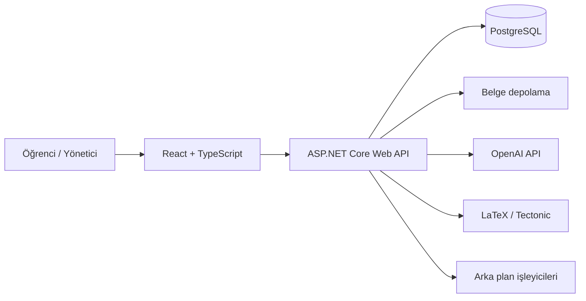

# NotMark

**NotMark**, üniversite öğrencilerinin ders notlarını keşfedebildiği, not talebi oluşturabildiği, içerik paylaşabildiği ve satın alma süreçlerini takip edebildiği akademik not platformudur. Öğrenci deneyimi ile yönetim, moderasyon ve belge işleme süreçlerini tek bir sistemde birleştirir.

> **Proje durumu:** Aktif geliştirme. Öğrenci ve yönetici arayüzleri ile üretim dağıtım altyapısı mevcuttur. Bazı iş akışları ve güvenlik iyileştirmeleri geliştirme aşamasındadır.

## İçindekiler

- [Özellikler](#özellikler)
- [Teknoloji yığını](#teknoloji-yığını)
- [Mimari](#mimari)
- [Proje yapısı](#proje-yapısı)
- [Yerel geliştirme](#yerel-geliştirme)
- [Yapılandırma ve güvenlik](#yapılandırma-ve-güvenlik)
- [Doğrulama ve CI/CD](#doğrulama-ve-cicd)
- [Katkı ve geliştirme notları](#katkı-ve-geliştirme-notları)

## Özellikler

### Öğrenci deneyimi

- Öğrenci hesabı oluşturma, oturum açma ve profil yönetimi
- Üniversite ve akademik birim bilgileriyle öğrenci doğrulama süreci
- Akademik notları keşfetme ve not talepleri oluşturma
- Taleplere not gönderme ve gönderim durumlarını takip etme
- Satın alınan notları, kazanç bilgilerini ve hesap ayarlarını görüntüleme
- Not ve işlem süreçleriyle ilgili şikâyet bildirme

### Yönetim ve moderasyon

- Rol bazlı yönetici girişi ve korumalı yönetim uç noktaları
- Dashboard, kullanıcı yönetimi ve öğrenci doğrulama incelemesi
- Not başvurularını inceleme, onaylama ve reddetme
- Raporlar, şikâyet yönetimi ve denetim kayıtları (audit logs)
- Akademik katalog ve üniversite / fakülte / program verilerinin yönetimi

### Yapay zekâ ve belge işleme

- Not içeriklerinin yapay zekâ destekli değerlendirilmesi
- Kaynak notlardan standartlaştırılmış LaTeX/PDF üretim akışı
- Arka plan kuyruklarıyla not inceleme ve PDF oluşturma
- Belge üretim durumlarının ve çıktı bilgilerinin kaydedilmesi
- Üretim ortamında özel nesne depolama alanlarıyla belge saklama

> Yapay zekâ tabanlı işlemler harici servis erişimi ve uygun yapılandırma gerektirir. Otomatik değerlendirmeler, insan moderasyonunun yerine geçen kesin doğrulamalar olarak değerlendirilmemelidir.

## Teknoloji yığını

| Katman | Teknolojiler |
| --- | --- |
| Backend | C#, ASP.NET Core 10 Web API |
| Frontend | React 19, TypeScript, Vite, React Router, Axios |
| Veritabanı | PostgreSQL 16+, Entity Framework Core, Npgsql |
| Kimlik doğrulama | JWT Bearer, rol tabanlı yetkilendirme |
| Yapay zekâ | OpenAI API entegrasyonu |
| PDF işleme | LaTeX, Tectonic |
| Dosya depolama | Geliştirmede yerel depolama; üretimde Supabase Storage (S3 uyumlu API) |
| Dağıtım | Docker, Azure Container Registry, Azure App Service, Azure Static Web Apps |
| CI/CD | GitHub Actions |

## Mimari



- **Frontend:** Öğrenci ve yönetici ekranlarını, yönlendirmeyi ve API isteklerini yönetir.
- **Backend:** Kimlik doğrulama, yetkilendirme, iş kuralları, moderasyon, sipariş ve belge işleme süreçlerini yürütür.
- **Veritabanı:** Kullanıcılar, akademik bilgiler, talepler, gönderimler, siparişler ve denetim kayıtlarını tutar.
- **Belge işleme:** Geliştirmede yerel disk, üretimde özel depolama alanları kullanılır; PDF işlemleri arka planda çalıştırılır.

## Proje yapısı

```text
NotMark/
├── backend/
│   └── NotMarket.Api/
│       ├── Controllers/      # API uç noktaları
│       ├── Contracts/        # İstek / yanıt modelleri
│       ├── Data/             # DbContext, seed ve akademik katalog
│       ├── Domain/           # Alan modelleri
│       ├── Migrations/       # EF Core migration dosyaları
│       └── Services/         # İş kuralları ve entegrasyonlar
├── frontend/
│   └── src/
│       ├── api/             # HTTP istemcisi
│       ├── auth/            # Kimlik doğrulama bileşenleri
│       ├── components/      # Ortak bileşenler
│       ├── layout/          # Öğrenci / yönetici yerleşimleri
│       └── pages/           # Sayfalar
├── .github/workflows/       # CI ve manuel üretim dağıtımı
├── security/                # Güvenlik çalışma dosyaları
└── docker-compose.yml       # Yerel PostgreSQL
```

> `NotMarket.Api` adı backend projesinin mevcut teknik adıdır; kullanıcıya sunulan ürün adı **NotMark**'tır.

## Yerel geliştirme

### Gereksinimler

- **.NET 10 SDK**
- **Node.js 22+** ve npm
- **Docker Desktop** (önerilir) veya yerel PostgreSQL 16+
- Git
- PDF üretimini yerelde çalıştırmak için **Tectonic**
- Yapay zekâ entegrasyonu için geçerli bir **OpenAI API anahtarı**

### 1. Repoyu klonlayın

```bash
git clone https://github.com/acoci0/NoteMark.git
cd NoteMark
```

### 2. PostgreSQL'i başlatın

```bash
docker compose up -d
```

Docker Compose, PostgreSQL'i bilgisayarınızın **5433** portunda erişilebilir hâle getirir (container içinde 5432). Geliştirme bağlantı ayarı bu portla uyumludur.

### 3. Backend'i çalıştırın

```bash
cd backend/NotMarket.Api
dotnet restore

# Kişisel anahtarları kaynak koda yazmadan yerel olarak saklayın.
dotnet user-secrets set "OpenAI:ApiKey" "<OPENAI_API_KEY>"

# Geliştirme yönetici hesabının kimlik bilgilerini özelleştirin.
dotnet user-secrets set "SeedAdmin:Email" "<ADMIN_EMAIL>"
dotnet user-secrets set "SeedAdmin:Password" "<GUCLU_YONETICI_PAROLASI>"

dotnet run --launch-profile https
```

- HTTPS API: `https://localhost:7001`
- Sağlık denetimi: `https://localhost:7001/health`
- Gerekirse yerel HTTPS sertifikasına güvenmek için `dotnet dev-certs https --trust` komutunu çalıştırın.

**Migration notu:** Mevcut EF Core migration dosyaları repoda tutulur. Backend, `Development` ortamında başlangıçta bekleyen migration'ları uygular. Her kurulumda yeniden `dotnet ef migrations add InitialCreate` çalıştırmayın; bu komut yeni migration üretmek içindir.

**Yapılandırma notu:** Backend başlangıçta OpenAI yapılandırmasını doğrular. Geçerli bir API anahtarı tanımlanmamışsa uygulama başlatılamaz. PDF üretimi için ayrıca `tectonic` komutunun çalıştırılabilir olması gerekir.

### 4. Frontend'i çalıştırın

Ayrı bir terminalde repo kökünden:

```bash
cd frontend
cp .env.example .env
npm ci
npm run dev
```

Uygulama: **http://localhost:5173**

`frontend/.env` içindeki `VITE_API_BASE_URL`, yerel API adresini göstermelidir:

```dotenv
VITE_API_BASE_URL=https://localhost:7001/api
```

## Yapılandırma ve güvenlik

Aşağıdaki anahtarlar uygulamanın yapılandırma bölümleriyle eşleşir:

| Ayar | Açıklama |
| --- | --- |
| `ConnectionStrings__DefaultConnection` | PostgreSQL bağlantısı |
| `Jwt__Key` | JWT imzalama anahtarı (en az 32 bayt) |
| `Jwt__Issuer` / `Jwt__Audience` | JWT doğrulama parametreleri |
| `SeedAdmin__Email` / `SeedAdmin__Password` | Geliştirme ortamında oluşturulan yönetici hesabı |
| `OpenAI__ApiKey` | Yapay zekâ servisi anahtarı |
| `NotePdfGeneration__CompilerPath` | LaTeX derleyicisinin yolu |
| `Cors__AllowedOrigins__0` | Üretimde izin verilen frontend origin'lerinden ilki |
| `SupabaseStorage__*` | Üretim ortamı belge depolama ayarları |

.NET yapılandırmasında ortam değişkenleri için `:` yerine `__` kullanılır (örnek: `OpenAI__ApiKey`). Yerel geliştirmede `dotnet user-secrets`, üretimde güvenli ortam değişkenleri / platform secrets tercih edilmelidir.

**Güvenlik ilkeleri:**

- Gerçek API anahtarlarını, erişim bilgilerini, JWT anahtarlarını veya özel bağlantı dizelerini repoya eklemeyin.
- Geliştirme ortamındaki örnek yönetici bilgilerini hiçbir zaman üretim hesabı olarak kullanmayın.
- Yetki kontrollerini yalnızca frontend görünürlüğüne bırakmayın; ilgili API uç noktalarında sunucu tarafında doğrulayın.
- Kimlik doğrulama, dosya yükleme, ödeme/sipariş ve belge işleme akışlarını canlıya almadan önce ayrıca güvenlik testinden geçirin.
- Kullanıcı belgelerini ve kişisel verileri özel depolama alanlarında, en az yetki prensibiyle yönetin.

## Doğrulama ve CI/CD

### Yerel kontroller

Repo kökünden:

```bash
dotnet restore backend/NotMarket.Api/NotMarket.Api.csproj
dotnet build backend/NotMarket.Api/NotMarket.Api.csproj -c Release

cd frontend
npm ci
npm run lint
npm run build
```

### GitHub Actions

| İş akışı | Tetikleyici | İşlem |
| --- | --- | --- |
| `.github/workflows/main.yml` | `main` push / pull request | Backend build, frontend lint ve build |
| `.github/workflows/deploy-backend.yml` | Manuel (`workflow_dispatch`) | Container build, Azure Container Registry, App Service dağıtımı ve health check |
| `.github/workflows/deploy-frontend.yml` | Manuel (`workflow_dispatch`) | Frontend build ve Azure Static Web Apps dağıtımı |

Üretim dağıtımları **`main`** dalı üzerinden ve **manuel** olarak tetiklenir. GitHub Actions secrets ile üretim uygulama yapılandırması birbirinden ayrı yönetilmelidir.

## Katkı ve geliştirme notları

Proje aktif olarak geliştirilmektedir. Değişiklik yaparken mevcut çalışan akışların korunması, veritabanı migration'larının dikkatle yönetilmesi, rol bazlı yetkilendirmenin kontrol edilmesi ve ilgili build/lint adımlarının başarıyla tamamlanması beklenir.

Hata bildirimleri ve geliştirme önerileri için [GitHub Issues](https://github.com/acoci0/NoteMark/issues) kullanılabilir.

---

**NotMark — Akademik notları keşfet, paylaş ve değerlendir.**
